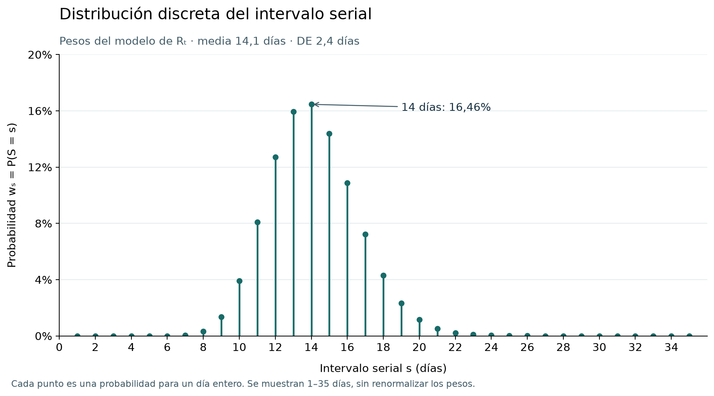

# Cómo se calcula Rₜ en este análisis

Rₜ es el número reproductivo efectivo en el momento t: cuántas personas contagia,
en promedio, una persona infectada bajo las condiciones de ese momento.

- **Rₜ > 1:** la transmisión tiende a crecer.
- **Rₜ < 1:** tiende a disminuir.
- **Rₜ ≈ 1:** tiende a mantenerse estable.

Aquí se estima a partir de conteos diarios de vigilancia mediante un modelo de renovación
Poisson–Gamma, siguiendo el enfoque de [Cori et al. (2013)](https://pmc.ncbi.nlm.nih.gov/articles/PMC3816335/),
implementado por Cori y colaboradores en el paquete de R [EpiEstim](https://mrc-ide.github.io/EpiEstim/).
Este proyecto utiliza una implementación propia en Python que reproduce el cálculo
y la discretización del intervalo serial de ese paquete.

## Definiciones y fundamento matemático

### Conteo diario y distribución Poisson

Sea $I_t$ la variable aleatoria que representa el número de registros del día
$t$, e $i_t$ su valor observado. Aquí son notificaciones o inicios de síntomas,
según la fecha elegida; no son infecciones observadas directamente.

El **intervalo serial** es el tiempo entre el inicio de síntomas de quien contagia
y el de la persona contagiada. Por ejemplo, si presentan síntomas los días 1 y 15,
respectivamente, el intervalo serial es de 14 días.

Ese tiempo varía entre parejas de personas. En este modelo, el intervalo serial
$S$ es una **variable aleatoria discreta**, medida en días:

$$
S\in\{1,2,3,\ldots\}.
$$

Los pesos $w_s$ son los valores de su **función de masa de probabilidad**:

$$
w_s=P(S=s).
$$

Es decir, $w_s$ indica la probabilidad de que transcurran $s$ días entre los
inicios de síntomas. No es la probabilidad de que una persona contagie a otra.

La siguiente gráfica usa la misma distribución discretizada que el estimador:
Gamma desplazada con media 14,1 días y desviación estándar 2,4 días.
El eje horizontal muestra los días $s$ y el vertical, $w_s=P(S=s)$.
Son puntos para días enteros, no una densidad continua.

Los valores de **media 14,1 días y desviación estándar 2,4 días** proceden de los
datos históricos de varicela de [Simpson (1952), en Inglaterra](https://doi.org/10.1016/S0140-6736(52)91357-3),
reanalizados por [Vink et al. (2014), tabla 3](https://doi.org/10.1093/aje/kwu209).
La [reproducción del análisis de Vink](https://kylieainslie.github.io/mitey/articles/code_validation_for_Vink_method.html)
también documenta esos valores y el uso de una distribución normal en ese análisis.

Para construir los pesos diarios, se reproduce el algoritmo de
[`discr_si` de EpiEstim](https://mrc-ide.github.io/EpiEstim/reference/discr_si.html),
que utiliza una Gamma desplazada un día. Así se obtiene una aproximación que
conserva la media y la desviación estándar bibliográficas. Los parámetros no se
estimaron con registros colombianos.

Con estos parámetros, $w_{14}\approx 0{,}1646$: el modelo asigna aproximadamente
un 16,46 % de probabilidad a un intervalo de 14 días. Es una distribución asumida,
no una frecuencia estimada con los registros de Sivigila.
La figura muestra los días 1–35 sin renormalizar los pesos; el soporte del modelo
continúa más allá.

Los pesos cumplen $w_s\geq 0$ y $\sum_{s\geq 1}w_s=1$. Por eso, la suma

$$
\Lambda_t=\sum_{s=1}^{t-1}i_{t-s}w_s
$$

pondera los conteos anteriores según cuántos días han pasado. Es una cantidad
calculada, no un conteo de personas infecciosas observadas: por ejemplo,
10 casos de un día anterior con un peso hipotético de 0,2 aportan 2 unidades a $\Lambda_t$.

El intervalo serial corresponde a fechas de **inicio de síntomas**, pero esa
fecha está incompleta en Sivigila. En la auditoría de los archivos 2007–2025,
todos los registros incluidos tienen una fecha de notificación interpretable,
mientras que 55.701 no tienen una fecha de inicio de síntomas interpretable;
55.686 de esos faltantes corresponden al archivo de 2013. Usar solo las fechas
de síntomas disponibles dejaría, por tanto, vacíos concentrados en determinados
periodos. La [auditoría de las series](rt_stratified/README.md) documenta este
procesamiento.

Por esa mayor completitud, se utiliza la **fecha de notificación como aproximación
para describir la evolución temporal**, junto con una segunda estimación por
inicio de síntomas para contrastar los resultados. Esto no convierte las fechas
de notificación en fechas de contagio ni corrige automáticamente los faltantes
de la serie por síntomas.

La justificación de la aproximación es que, si la demora entre síntomas y
notificación fuera igual para todos los casos, la curva se desplazaría en el
tiempo, pero conservaría su forma y los intervalos entre casos. Para un transmisor
$i$ y su caso secundario $j$, con fecha de síntomas $O$, fecha de notificación
$N$ y demora $D=N-O$:

$$
N_j-N_i=(O_j-O_i)+(D_j-D_i).
$$

Si las demoras son parecidas, $D_j-D_i$ es pequeño y el intervalo entre
notificaciones aproxima el intervalo serial. En la práctica se necesita que
las demoras tengan poca variabilidad y sean suficientemente estables en el
periodo interpretado. Una demora estable solo en promedio no garantiza esa
equivalencia: su variación puede suavizar o deformar la curva. Los retrasos
también desplazan la fecha de los cambios estimados de Rₜ, como explican
[Gostic et al. (2020)](https://pmc.ncbi.nlm.nih.gov/articles/PMC7728287/).

El [análisis de demoras del proyecto](https://github.com/thesis-varicella-colombia/exploratory-analysis/blob/main/notebooks/03_demora_notificacion_sivigila.ipynb)
encontró una mediana de 2 días, con la mitad central entre 1 y 4 días, y un 67,4 %
de registros notificados entre el inicio de síntomas y tres días después. Esto
favorece una lectura aproximada de patrones a escala de semanas. Sin embargo,
la proporción con demora mayor que siete días pasó de 4,6 % en 2009–2011 a
17,7 % en 2019–2025: **la distribución de demoras no fue constante en toda la serie**.

Por ello, el resultado por notificación se interpreta como una estimación
exploratoria de patrones de vigilancia. La completitud de esa fecha y las demoras
cortas de muchos registros motivan su uso, pero no demuestran que el sesgo en Rₜ
sea pequeño ni que sus cambios estén fechados con precisión. La comparación con
la ruta por síntomas ayuda a evaluar diferencias donde ambas tienen información;
no elimina los sesgos ni valida por sí sola la aproximación.

$\Lambda_t$ resume la contribución de los registros anteriores al conteo actual,
según los pesos del intervalo serial. Al multiplicarla por $R_t$, se obtiene
el conteo medio esperado del día: $R_t\Lambda_t$.

La **historia observada**, representada por $\mathcal H_{t-1}$, es el conjunto de
conteos diarios que ya conocemos antes del día $t$. Por ejemplo, para analizar
el día 4, incluye los conteos de los días 1, 2 y 3. No se refiere a las historias
clínicas de las personas. Con esos conteos y los pesos fijados, $\Lambda_t$ se
calcula directamente. El modelo para el conteo del día $t$ es:

$$
I_t\mid R_t,\mathcal H_{t-1}\sim\operatorname{Poisson}(R_t\Lambda_t).
$$

La **media de la Poisson es $R_t\Lambda_t$**. Su media y
varianza condicionales son iguales a $R_t\Lambda_t$. $R_t$ es el factor de
reproducción positivo que se quiere estimar, no un conteo ni una probabilidad.

### Distribución previa Gamma para Rₜ

En el enfoque bayesiano, la incertidumbre sobre ese parámetro se representa con
una distribución previa:

$$
R_t\sim\operatorname{Gamma}(\alpha,\beta),
\qquad\alpha>0,\quad\beta>0.
$$

Aquí $\alpha$ es la **forma** y $\beta$ la **tasa**; la escala sería $1/\beta$.
Con esta parametrización:

$$
\mathbb E[R_t]=\frac{\alpha}{\beta},
\qquad
\operatorname{Var}(R_t)=\frac{\alpha}{\beta^2}.
$$

La previa expresa incertidumbre sobre Rₜ antes de incorporar los conteos de la
ventana. No describe diferencias de contagios entre personas. Los scripts fijan
$\alpha=1$ y $\beta=0{,}2$: media 5, varianza 25 y desviación estándar 5.
Es una previa relativamente vaga, elegida siguiendo la
[configuración predeterminada de EpiEstim](https://github.com/mrc-ide/EpiEstim/blob/master/R/make_config.R#L291-L292).
Su amplitud busca limitar su influencia y permitir que la verosimilitud Poisson,
basada en los conteos y la infectividad de la ventana, tenga mayor peso en la
posterior cuando hay información suficiente. Esto no elimina la influencia de
la previa: en ventanas con poca información puede seguir siendo importante.

### Verosimilitud y posterior conjugada

Para estimar el valor asociado al día $t$, se supone un mismo parámetro
$R_{t,\tau}$ durante la ventana $W_t=\{t-\tau+1,\ldots,t\}$, con $\tau=14$ días.
En las gráficas de Rₜ por fecha de notificación y por inicio de síntomas,
este parámetro se representa como Rₜ. Se definen:

$$
C_t=\sum_{u\in W_t}i_u,
\qquad
L_t=\sum_{u\in W_t}\Lambda_u.
$$

El producto de las probabilidades Poisson **condicionales a la historia** da
la verosimilitud del parámetro. Omitiendo los factores que no dependen de $r$:

$$
\mathcal L_t(r)
=\prod_{u\in W_t}
\frac{(r\Lambda_u)^{i_u}e^{-r\Lambda_u}}{i_u!}
\ \propto\ r^{C_t}e^{-rL_t}.
$$

La densidad previa Gamma tiene la forma
$p(r)\propto r^{\alpha-1}e^{-\beta r}$, para $r>0$. Por el teorema de Bayes:

$$
p(r\mid\text{datos})
\propto\mathcal L_t(r)p(r)
\propto r^{\alpha+C_t-1}e^{-(\beta+L_t)r}.
$$

Esta expresión es el núcleo de otra Gamma. Por eso se dice que la Gamma es
**conjugada** para la verosimilitud Poisson con exposición conocida:

$$
R_{t,\tau}\mid\text{datos}
\sim\operatorname{Gamma}(\alpha+C_t,\ \beta+L_t).
$$

La actualización suma los casos a la forma y la infectividad a la tasa.
La línea de las gráficas de Rₜ representa la media posterior:

$$
\widehat R_t=\frac{\alpha+C_t}{\beta+L_t}
=\frac{1+C_t}{0{,}2+L_t}.
$$

Los percentiles 2,5 y 97,5 de esa posterior forman la banda creíble del 95 %.
La conjugación permite calcularlos directamente, sin simulación ni MCMC.
En SciPy se utiliza escala $1/(\beta+L_t)$.

Cada ventana usa la misma previa; la posterior de ayer no se utiliza como previa
de hoy. Las ventanas comparten observaciones y sus resultados no son independientes.
La Gamma previa de Rₜ y la Gamma desplazada del intervalo serial cumplen funciones
distintas: la primera expresa incertidumbre sobre Rₜ; la segunda determina los pesos
$w_s$. La formulación sigue el enfoque de
[Cori et al.](https://pmc.ncbi.nlm.nih.gov/articles/PMC3816335/) y la
[documentación de EpiEstim](https://mrc-ide.github.io/EpiEstim/articles/full_EpiEstim_vignette.html).

## 1. Contar los registros por día

Se utilizan los CSV individuales `Datos_AAAA_831.csv` de varicela (evento 831),
documentados en el [README de Sivigila de data-processing](https://github.com/thesis-varicella-colombia/data-processing/tree/main/data/raw/sivigila#esquema-y-diccionario-de-datos).
Los archivos originales no se publican allí debido a su tamaño.

Se conservan los registros con residencia válida en DIVIPOLA, se homologan códigos
históricos y se excluyen los ajustes `6` y `D`. Se construyen dos series:

- **Notificación:** cada registro se cuenta en su fecha `FEC_NOT`.
- **Inicio de síntomas:** se cuenta en `INI_SIN`, si es interpretable. El lector
  contempla el formato mes/día/año de esa columna en el archivo de 2013; para los
  demás años utiliza día/mes/año.

Los días se cuentan directamente: no se reconstruyen desde totales semanales.
Se analizan los años epidemiológicos 2008–2025; 2007 queda fuera por la discrepancia
de cobertura documentada. El modelo recibe **conteos**, no tasas por población.

Los totales diarios se contrastan con la [serie semanal por notificación](../evolucion_semanal/README.md)
y, para síntomas, con el integrado `sivigila_integrado_symptom_semanal_municipal.parquet`,
descrito en el [README de integración](https://github.com/thesis-varicella-colombia/data-processing/blob/main/data/processed/integration_data/README.md).

## 2. Ponderar los casos de días anteriores

El modelo compara los casos observados con la «infectividad» que aportaría la
historia reciente. Un caso de hace varios días recibe un peso según cuánto tiempo
ha pasado; esos pesos se obtienen de una distribución del intervalo serial.
Este intervalo es el tiempo entre el inicio de síntomas de un transmisor y el
de su caso secundario; no es la demora entre síntomas y notificación de una persona.

| Parámetro | Valor utilizado |
| --- | --- |
| Distribución del intervalo serial | Gamma desplazada, discretizada en días según [`discr_si` de EpiEstim](https://mrc-ide.github.io/EpiEstim/reference/discr_si.html) |
| Media del intervalo serial | 14,1 días |
| Desviación estándar | 2,4 días |
| Ventana de estimación | 14 días, incluido el día de la estimación |
| Distribución previa de Rₜ | Gamma con forma 1 y tasa 0,2; media 5 y desviación estándar 5 |

Estos parámetros están fijados en los scripts: el intervalo serial no se estima
con los datos de Sivigila. Los pesos se mantienen iguales durante el análisis.

## 3. Estimar Rₜ en cada ventana

El script aplica la actualización conjugada definida arriba a cada ventana de
14 días: suma sus conteos e infectividades, calcula la posterior Gamma y guarda
su media y sus percentiles 2,5 y 97,5. La ventana avanza un día cada vez.

La media se publica como `rt` y los límites como `rt_lower_95` y
`rt_upper_95`. Son los valores que representan la línea y la banda de la gráfica.

## 4. Conservar los vacíos y respetar la historia disponible

Una semana ausente de la referencia nacional se conserva sin datos en todos sus
días; no se convierte en cero. Esto incluye la semana 52 de 2008 por notificación.
Dentro de una semana nacional observada, los días sin registros de una selección
se cuentan como cero, sin que ello demuestre ausencia real de enfermedad.

El estimador reinicia después de cada vacío. Solo publica una ventana cuando
hay historia suficiente para cubrir al menos el 99 % de la masa de los pesos
seriales desde su primer día, además de las comprobaciones de inicio de serie.
En los estratos también se omiten las ventanas sin exposición infecciosa previa.
El reinicio reduce el problema de borde, pero no recupera la historia anterior
al vacío.

## Territorios, visualización e interpretación

Para un departamento se suman primero los conteos diarios de sus municipios y
después se estima Rₜ; **no se promedian los Rₜ municipales**. Los análisis por edad
y por territorio son marginales separados, no un cruce edad × municipio.

La [versión para visualización](rt_visualization/README.md) resume las series para
su carga en el navegador; no vuelve a estimar Rₜ. Los resultados diarios completos
se conservan en [rt_stratified](rt_stratified/README.md). Los criterios de precisión
son diagnósticos adicionales y no cambian el estimador.

Rₜ mayor, menor o cercano a 1 sugiere crecimiento, descenso o estabilidad bajo
los supuestos del modelo. El intervalo mostrado no incorpora incertidumbre del
intervalo serial, subregistro ni cambios de vigilancia. `FEC_NOT` puede desplazar
la señal respecto al contagio; `INI_SIN` tampoco observa la fecha de infección
y puede estar incompleta. Los resultados no distinguen automáticamente contagios
locales de importados ni identifican efectos causales de vacunación.

## Lectura de las gráficas

La línea representa la media posterior y la banda, el intervalo creíble condicional
del 95 %. Si el intervalo incluye 1, no permite distinguir con claridad el lado
del umbral. Rₜ no indica cuántos casos hay ni equivale a R₀, el número reproductivo
básico de una población totalmente susceptible.

Los filtros cambian las dos series y el detalle de 2013–marzo de 2014; la selección
territorial incluye todas las edades y es independiente de las casillas de las
gráficas semanales. La vista principal por síntomas comienza con un eje de 0–2;
«Mostrar escala completa» permite ver los valores mayores. El detalle conserva
todos los puntos diarios y tiene propósito diagnóstico: en el archivo de 2013,
solo 37.920 de 93.606 registros elegibles (40,5 %) tienen inicio de síntomas
interpretable. Hay 20 semanas sin total por síntomas en 2008–2025, 18 de ellas en 2013.

La vista general utiliza promedios adaptativos de hasta siete días, conservando
extremos, cruces de Rₜ = 1 e interrupciones. Su banda resume los límites diarios;
no es un intervalo recalculado para el promedio. Las marcas verticales señalan
aproximadamente las semanas 27 de 2015 y 2019; la franja gris abarca desde la
semana 12 de 2020 hasta 2021. Tras el vacío de notificación de 2008, la primera
estimación nacional vuelve a estar disponible el 30 de enero de 2009.

## Archivos y cuadernos de referencia

Las especificaciones de cada gráfica se documentan por separado:

- [Rₜ nacional por fecha de notificación](README_notification.md).
- [Rₜ nacional por inicio de síntomas](README_symptom.md).
- [Detalle de 2013–marzo de 2014](README_symptom_detail.md).

- [Rₜ nacional diario por notificación (CSV)](rt_national_daily.csv).
- [Rₜ nacional diario por inicio de síntomas (CSV)](rt_national_symptom_daily.csv).
- [Referencia semanal por síntomas y semanas faltantes (CSV)](weekly_series_symptom_2008_2025.csv).
- [Cuaderno del cálculo por notificación](https://github.com/thesis-varicella-colombia/exploratory-analysis/blob/main/notebooks/05_rt_nacional_diario.ipynb).
- [Cuaderno del cálculo por inicio de síntomas](https://github.com/thesis-varicella-colombia/exploratory-analysis/blob/main/notebooks/06_rt_nacional_inicio_sintomas.ipynb).

## Scripts del cálculo

- [`plot_serial_interval.py`](https://github.com/thesis-varicella-colombia/exploratory-analysis/blob/main/scripts/plot_serial_interval.py): genera la figura de $w_s$ usando la misma función de discretización y los parámetros predeterminados del estimador. Se reproduce con `.venv/bin/python scripts/plot_serial_interval.py`.
- [`rt_daily_sivigila.py`](https://github.com/thesis-varicella-colombia/exploratory-analysis/blob/main/scripts/rt_daily_sivigila.py): conteos por notificación y estimador compartido `estimate_daily`.
- [`rt_symptom_sivigila.py`](https://github.com/thesis-varicella-colombia/exploratory-analysis/blob/main/scripts/rt_symptom_sivigila.py): conteos por inicio de síntomas y aplicación del mismo estimador.
- [`epiestim_parametric_weekly.py`](https://github.com/thesis-varicella-colombia/exploratory-analysis/blob/main/scripts/epiestim_parametric_weekly.py): aporta `discr_si` para discretizar el intervalo serial; la ruta semanal de ese módulo es un análisis separado del diario descrito aquí.
- [`generate_rt_stratified.py`](https://github.com/thesis-varicella-colombia/exploratory-analysis/blob/main/scripts/generate_rt_stratified.py): estimaciones y archivos por grupo de edad y territorio.
- [`reduce_rt_visualization.py`](https://github.com/thesis-varicella-colombia/exploratory-analysis/blob/main/scripts/reduce_rt_visualization.py): reducción para visualización, sin reestimación.
